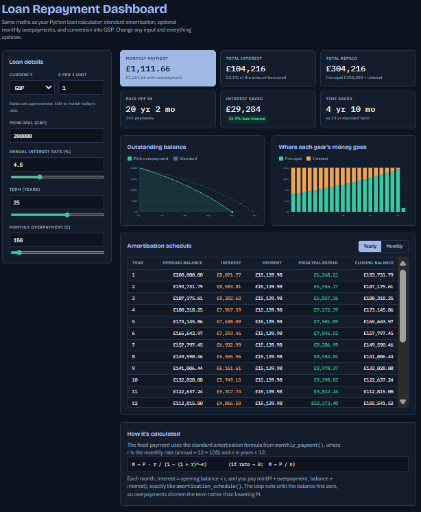

The project is available as a dasboard.

Description:
Mortgage & Loan Amortisation Calculator is a Python program that calculates monthly loan payments and generates an amortisation schedule based on a user's loan amount, annual interest rate, loan term, and optional overpayments.
Most people may know what their monthly payments are, but not how much of it is actually going towards the loan and how much is interest. If you were to take out a loan of 200,000 at an annual rate of 5% over 25 years, in month one you are charged with £833.33 in interest and only £335.85 that really goes to the original amount, which allows users to visualise how much money they are really to get a grasp on what loans would benefit them more in the long term. It also allows users to see what it would be like if they added some overpayments. For example, if I continue off my previous statement, and the customer decides to put another £200 of overpayment into the mix, the total number of months is cut by 74 months, reducing it to only 226 months instead of the full 300, showing the user how effective an overpayment would be and by how much the loan can be cut short, allowing them to create budgets and forecasts for the future.

Files included:

project.py - This contains main() and three other functions, these being monthly_payment(), amortisation_schedule() and total_interest().

monthly_payment() - Monthly payments main role is to calculate how much the individual needs to pay each month through the standard loan amortisation formula and storing it within the variable "m", serving as the basis for amortisation_schedule.

amortisation_schedule() - This function calculates the old balance, new balance, payment for the month, interest and principal repaid and also serves to store these all in a dictionary through every iteration of the loop in order to serve it back to main in order to be formatted by tabulate and put into a table.

total_interest() - Total interest serves as an extra once the monthly_payments has been calculated and the amortisations schedule has been displayed. Its purpose is to allow the user to compare the interest they would have paid and compare them against different loan plans they have been offered by banks. For example, continuing, once again, off my previous statement I can see that the total interest paid from the loan of £200,000 is £150,754.02. Now lets say the user was offered another loan for £200,000 at 3.2% interest for 42 years, although the lower rates may seem more favourable, in reality you are paying 163,866.40, which is £13,112.38 more.

test_project.py - This tests whether output will be right and how the programme handles negative numbers and 0s as an input. In total there is 13 assertions and 11 pytest.raises(ValueError) checks.

Requirements.txt - Shows the two libraries and why I used them.

Design Choices
My original monthly_payment() didn't take any parameters and only took in four inputs, called itself and returned the answer. This caused a problem as when pytest came to validate my functions, there would be no one there to manually type in the answers to prove it worked. In order to change this and get the validation functioning as intended I moved every input into main() allowing the function to now receive numbers and return them too. I also moved the ÷12 and ÷100 inside the function in order to make the arithmetic testable.

Another problem I ran into was formatting. Originally when feeding values into my dictionary (b), I formatted the values like so: {"Key": f"£{Variable}:.,2f", ...} which orginally looked alright within the table, but when it came to testing it gave me this error: TypeError: type str doesn't define round. and total_interest would've been summing text rather than numbers. To resolve this I had to remove the formatting in order to store it as the original value as tabulates floatfmt applies the formatting as display time.

During this I also had to handle a 0% interest rate, something that would not have worked as the code would reject an input of 0 when dividing. In order to solve this, I had to modify the annual rate so that if annual rate >= 0 the validation broke and allowed it through, and once it reached monthly_payments() (Which is where the main problem occurred) I solved it using an if statement, stating that if annual rate is 0, I just do m =principal loan / monthly payments, which is just the modified variation of the original formula, which allowed a 0% interest rate to successfully pass through.

Finally, I added min() in amortisation_schedule here: "payment_this_month = min(payment + overpayment, balance + interest)". Without it the last month will end up subtracting a full payment amount from a balance smaller than it, resulting in a negative number. This causes two problems:

Even though the while loop may be satisfied, there will be a recorded row that shows that the borrower paid more than they owe. This would've caused total_interest to sum a row that shouldn't exist.

Depending on the condition of the loop, there could be an extra month for a trivial amount.

To combat this, the added min() operator it caps each months payment at the smaller of the intended amount and outstanding debt. The cap is the balance + interest since the interest would be changed before the payment is applied. Capping only the balance would leave the interest unpaid and result in an additional month. With a £200 overpayment, the final payment is £845.91 rather than £1,369.18, which is similar to a real mortgage statement.
